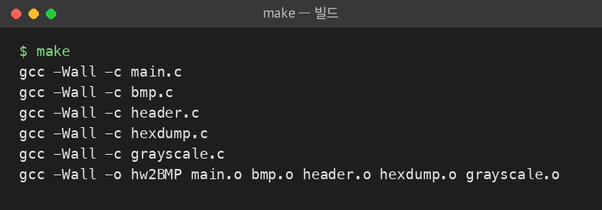
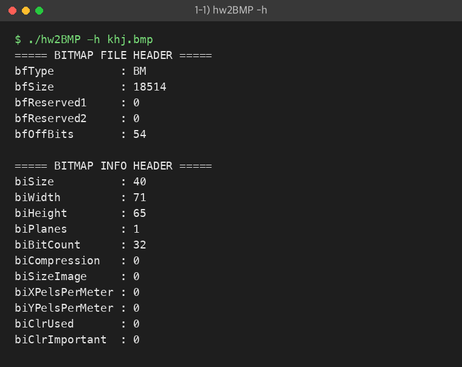
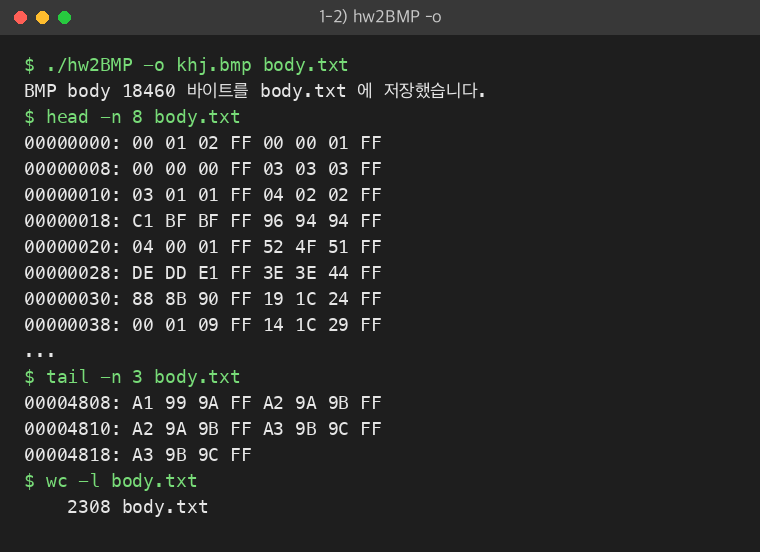
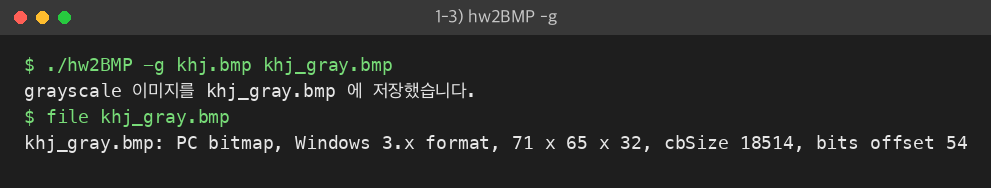
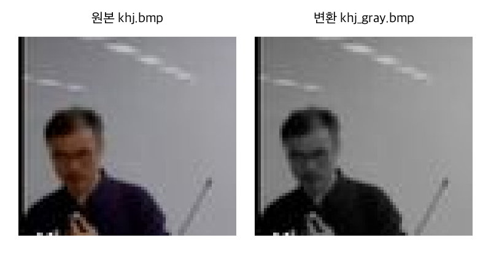
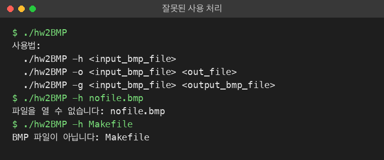
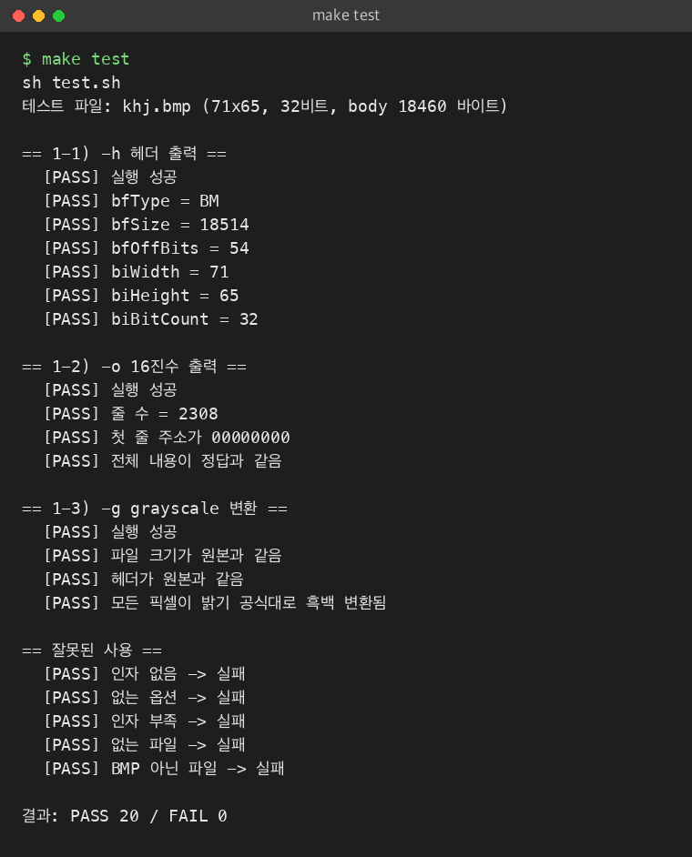

# 시스템 프로그래밍 팀과제 #1 — 이진 파일 다루기 (hw2BMP)

## 조원 명단 및 역할

| 이름 | 학번 | 역할 |
|---|---|---|
| 전도원 | 22300650 | 과제 1-1 (헤더 출력), 1-2 (body 16진수 출력) 수행 |
| 송준선 | 22300404 | 과제 1-3 (grayscale 변환) 수행, 데모 캡쳐 |

## 1. 과제 개요

BMP 이미지 파일을 이진 모드로 읽어서 다음 세 가지 기능을 옵션으로 실행하는 프로그램을 만들었다.

| 과제 | 명령 | 기능 |
|---|---|---|
| 1-1 | `hw2BMP -h <input_bmp_file>` | BMP 헤더 내용을 화면에 출력 |
| 1-2 | `hw2BMP -o <input_bmp_file> <out_file>` | BMP body를 16진수 텍스트로 출력 (한 줄 8바이트, 앞에 상대주소) |
| 1-3 | `hw2BMP -g <input_bmp_file> <output_bmp_file>` | grayscale로 바꿔서 새 BMP 파일로 저장 |

## 2. 파일 구성

| 파일 | 설명 |
|---|---|
| `Makefile` | 컴파일 규칙 (`make`, `make test`, `make clean`) |
| `bmp.h` | BMP 헤더 구조체와 함수 선언 |
| `bmp.c` | 헤더 읽기 함수 (세 기능이 같이 사용) |
| `header.c` | 과제 1-1 헤더 출력 |
| `hexdump.c` | 과제 1-2 body 16진수 출력 |
| `grayscale.c` | 과제 1-3 grayscale 변환 |
| `main.c` | 옵션을 확인하고 기능 실행 |
| `test.sh` | khj.bmp 로 세 기능을 자동 테스트하는 스크립트 |

## 3. 자료구조 설명

BMP 파일은 다음 순서로 되어 있다.

```
0바이트     : BITMAPFILEHEADER (14바이트)
14바이트    : BITMAPINFOHEADER (40바이트)
bfOffBits   : 픽셀 데이터 (body)
```

- 픽셀은 B, G, R (32비트는 B, G, R, A) 순서로 저장된다.
- 한 줄(row)의 크기는 4의 배수가 되도록 뒤에 0이 채워진다 (패딩).
- 보통 이미지의 아래쪽 줄부터 저장된다.

### BITMAPFILEHEADER (14바이트)
| 멤버 | 타입 | 의미 |
|---|---|---|
| bfType | unsigned short | 파일 종류, `'BM'` |
| bfSize | unsigned int | 파일 전체 크기 |
| bfReserved1, bfReserved2 | unsigned short | 사용 안 함 (0) |
| bfOffBits | unsigned int | 픽셀 데이터가 시작하는 위치 |

### BITMAPINFOHEADER (40바이트)
| 멤버 | 타입 | 의미 |
|---|---|---|
| biSize | unsigned int | 정보 헤더 크기 (40) |
| biWidth, biHeight | int | 가로, 세로 픽셀 수 |
| biPlanes | unsigned short | 항상 1 |
| biBitCount | unsigned short | 픽셀 하나의 비트 수 (24, 32 등) |
| biCompression | unsigned int | 압축 방식 (0 = 압축 안 함) |
| biSizeImage | unsigned int | 픽셀 데이터 크기 (0일 수 있음) |
| biXPelsPerMeter, biYPelsPerMeter | int | 해상도 |
| biClrUsed, biClrImportant | unsigned int | 색상 수 |

**`#pragma pack(1)` 을 쓴 이유**
- C 컴파일러는 구조체 멤버를 4바이트 단위로 맞추려고 사이에 빈 공간을 넣는다.
- 그러면 `bfType`(2바이트) 뒤에 2바이트가 비어서 BITMAPFILEHEADER가 14바이트가 아니라 16바이트가 된다.
- 이 상태로 `fread`로 읽으면 값이 밀린다.
- 그래서 `#pragma pack(1)`로 빈 공간 없이 1바이트 단위로 붙이도록 했다.

## 4. 함수 설명

### bmp.c
| 함수 | 기능 |
|---|---|
| `int read_header(FILE *fp, BITMAPFILEHEADER *fh, BITMAPINFOHEADER *ih)` | `fread`로 두 헤더를 읽고, `bfType`이 `'BM'`(0x4D42)인지 확인한다. 성공하면 0, 실패하면 -1 |

### header.c (과제 1-1)
| 함수 | 기능 |
|---|---|
| `int print_header(char *filename)` | 파일을 `"rb"`로 열고 `read_header`로 헤더를 읽어서, 모든 멤버 값을 출력한다 |

### hexdump.c (과제 1-2)
| 함수 | 기능 |
|---|---|
| `int hex_dump(char *in_name, char *out_name)` | 헤더를 읽은 뒤 `fseek`으로 `bfOffBits` 위치로 이동한다. 파일 끝까지 `fgetc`로 한 바이트씩 읽어 `%02X`로 출력한다. 읽은 바이트 수 `count`를 상대주소로 쓰고, `count % 8 == 0`일 때마다 줄 앞에 주소를 `%08X`로 붙인다 |

### grayscale.c (과제 1-3)
| 함수 | 기능 |
|---|---|
| `int make_gray(char *in_name, char *out_name)` | 파일 전체를 `malloc`한 메모리에 읽는다. 행/열 이중 for문으로 픽셀마다 밝기를 계산해 B, G, R에 같은 값을 넣고, 결과를 `"wb"`로 저장한다. 24비트와 32비트 BMP를 지원한다 |

**grayscale 계산 방법**
- 밝기 = 0.299 R + 0.587 G + 0.114 B 공식을 쓴다.
- 실수 계산 대신 `(299*R + 587*G + 114*B + 500) / 1000` 처럼 정수로 계산한다. `+500`은 반올림을 위한 것이다.
- 한 줄의 크기는 `(width * 픽셀바이트수 + 3) / 4 * 4` 로 구해서 패딩을 건너뛴다.
- 32비트의 4번째 바이트(알파)는 바꾸지 않는다.

### main.c
| 함수 | 기능 |
|---|---|
| `void print_usage(char *name)` | 사용법 출력 |
| `int main(int argc, char *argv[])` | `argv[1]` 옵션과 인자 개수를 확인해서 알맞은 함수를 실행한다. 잘못 입력하면 사용법을 출력하고 1을 반환한다 |

## 5. 프로그램 사용법

```bash
# 컴파일
$ make

# 1-1) 헤더 출력
$ ./hw2BMP -h khj.bmp

# 1-2) body를 16진수 텍스트로 저장
$ ./hw2BMP -o khj.bmp body.txt

# 1-3) grayscale 변환
$ ./hw2BMP -g khj.bmp khj_gray.bmp

# 자동 테스트
$ make test

# 정리
$ make clean
```

## 6. 실행 결과 (데모)

### 컴파일 — `make`


### 1-1) `./hw2BMP -h khj.bmp`
khj.bmp는 71×65 픽셀의 32비트 이미지이고, 압축은 하지 않았다. 픽셀 데이터는 파일의 54번째 바이트부터 시작한다.



### 1-2) `./hw2BMP -o khj.bmp body.txt`
- body 크기는 71 × 65 × 4 = 18460 바이트이고, 한 줄에 8바이트씩이라 2308줄이 나온다.
- 마지막 줄 주소 0x4818 = 18456 이므로 상대주소가 맞게 증가한다.



### 1-3) `./hw2BMP -g khj.bmp khj_gray.bmp`


원본과 변환 결과 비교 (보기 쉽게 5배 확대):



### 잘못된 사용
인자가 맞지 않으면 사용법을 출력하고, 없는 파일이나 BMP가 아닌 파일은 오류 메시지를 출력한다.



## 7. 테스트

`make test` 를 실행하면 `test.sh` 가 khj.bmp 로 세 기능을 검사한다.
정답은 `od` 명령으로 khj.bmp 를 직접 읽어서 만들고, 프로그램 결과와 비교한다.

| 대상 | 검사 내용 |
|---|---|
| 1-1 `-h` | bfType, bfSize, bfOffBits, biWidth, biHeight, biBitCount 가 실제 파일 값과 같은지 |
| 1-2 `-o` | 줄 수, 첫 줄 주소, 전체 내용이 정답과 같은지 |
| 1-3 `-g` | 파일 크기와 헤더가 원본과 같은지, 모든 픽셀이 밝기 공식대로 바뀌었는지 |
| 잘못된 사용 | 인자 없음, 없는 옵션, 인자 부족, 없는 파일, BMP 아닌 파일일 때 실패하는지 |


